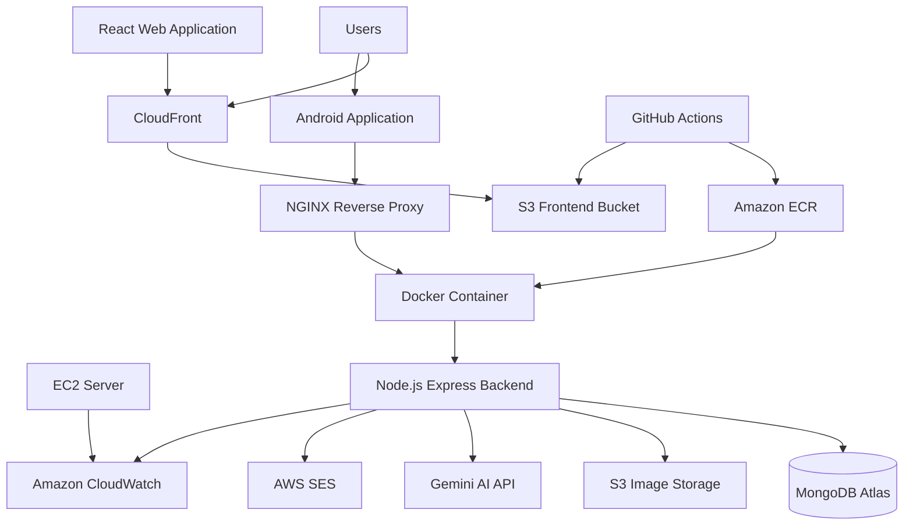
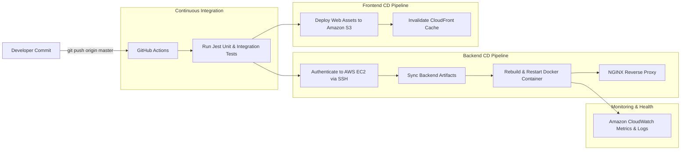

# Valoris — Waste Transaction Management System

[](https://nodejs.org/)
[](https://expressjs.com/)
[](https://react.dev/)
[](https://reactnative.dev/)
[](https://www.mongodb.com/atlas)
[-FF9900.svg)](https://aws.amazon.com/)
[](https://www.docker.com/)
[](https://ai.google.dev/)
[](license.txt)

---

## Overview

**Valoris** is a comprehensive **Waste Transaction Management System** designed to digitize, automate, and streamline waste material transactions, including transaction recording, material management, vendor and store management, weight tracking, financial calculations, reporting, and image documentation.

The platform consists of a **React.js web application** and an **Android mobile application (APK)**, both connected to a centralized **Node.js and Express.js backend** through REST APIs, ensuring consistent business logic and synchronized data across platforms.

It supports managing stores, vendors, material types, material rates, and transactions containing multiple material items, with each item maintaining its material type, weight, applicable rate, transaction amount, image, and weight source (manual or system-generated).

The Android application provides camera-based image capture and transaction image scanning capabilities, including an **OCR (Optical Character Recognition)** feature that analyzes transaction images, extracts relevant textual information, and automatically identifies or detects the applicable material rate from the scanned image, reducing manual data entry and improving operational efficiency and accuracy.

The system also incorporates **AI-powered image processing using Google's Gemini API** to assist with image analysis and weight-related data extraction, while allowing users to review and correct AI-generated values when necessary.

All transaction calculations, including item amounts, totals, receivable, payable, and net amounts, are handled centrally by the backend to maintain financial consistency and data integrity.

Transaction images and other uploaded files are stored securely in **Amazon S3**, while structured application data is managed in **MongoDB Atlas**; the platform also supports transaction summaries, store- and date-based filtering, dynamic reporting, selected-column report generation, and CSV export.

Authentication, authorization, input validation, and protected API access ensure secure communication between clients and the backend, while **AWS SES** handles email delivery.

The system is deployed using **Docker** on an **AWS EC2 instance** with **NGINX** as a reverse proxy, **Amazon ECR** for container image storage, **Amazon S3 and CloudFront** for frontend hosting and content delivery, **GitHub Actions** for automated CI/CD workflows, and **Amazon CloudWatch** for infrastructure monitoring, logging, and alerting.

Valoris is built with a modular, maintainable architecture focused on reliability, scalability, security, automation, and ease of use, providing a centralized platform for managing waste transactions and supporting future expansion into more advanced analytics, automation, and AI-driven operational workflows.

---

## System Architecture (HLD)

The system is organized into decoupled, scalable tiers:
1. **Client Tier**: Web client built with React.js (hosted via Amazon S3 and CloudFront CDN) and mobile client built as an Android APK (React Native / Expo) for store-level scanning and transaction entries.
2. **Gateway & Compute Tier**: AWS EC2 instance hosting NGINX as a reverse proxy and SSL termination point, routing traffic to containerized Node.js / Express.js backend running in Docker.
3. **Data & Cloud Services**: 
   - **MongoDB Atlas** for multi-tenant structured data, indexing, and transactional integrity.
   - **Amazon S3** for secure image documentation storage.
   - **Google Gemini AI API** for intelligent image analysis and OCR weight extraction.
   - **AWS SES** for high-deliverability transactional notifications and automated daily reports.
4. **CI/CD & Observability**:
   - **GitHub Actions** automating testing, image building, and automated deployment.
   - **Amazon ECR** for versioned Docker container image registry.
   - **Amazon CloudWatch** monitoring host metrics, container performance, and application log streams.

### Architecture Flowchart



---

## Key Features

### 1. Multi-Item Transaction Lifecycle
- **Dynamic Multi-Item Transactions**: Record single transactions with multiple material lines (e.g., cardboard, plastics, metals).
- **Comprehensive Item Tracking**: Each item maintains:
  - `materialType`: Category or material classification
  - `weight`: Detected or verified weight
  - `materialRate`: Applicable contract rate
  - `transaction amount`: Computed amount per material item
  - `image`: Uploaded scale reading or waste proof
  - `weightSource`: Tracking whether weight was populated `system` (AI/OCR) or `manually`
- **Centralized Financial Computation**: All calculations (item totals, overall total, receivable, payable, and net amounts) are computed centrally on the backend, safeguarding financial integrity and avoiding client-side calculation discrepancies.

### 2. Smart OCR & AI Weight Extraction (Google Gemini API)
- **Direct Camera & Scan Capture**: Android app captures high-resolution digital scale readings and physical transaction documents.
- **Automated Rate Detection**: Intelligent OCR parses transaction slips to automatically extract textual information and identify or detect the applicable material rate.
- **AI-Powered Weight Analysis**: Leverages Google Gemini API to read difficult 7-segment digital scale screens, analog dials, and weighbridge slips.
- **Human-in-the-Loop Verification**: Field operators can review AI-extracted weights and rates with fallback manual correction before submission.

### 3. Master Data Management
- **Store & Facility Management**: Centralized store profiles, geo-locations, states, and manager assignments.
- **Vendor Management**: Active vendor directories, contracts, and vendor-specific material rate catalogs.
- **Material & Rate Configuration**: Dynamic rate matrices mapped by store, region, material type, and effective dates.
- **Role-Based Access Control (RBAC)**: Secure multi-tier permissions for Admins, Managers, Stores, and Vendors.

### 4. Dynamic Reporting & Data Export
- **Custom Filtering**: Real-time filtering by store, vendor, date range, and material type.
- **Column Customization & Export**: Select specific columns for custom reports and download instant CSV exports.
- **Automated Daily Summaries**: Backend cron scheduler generates consolidated daily reports and transmits them automatically via AWS SES.
- **PDF Generation**: Standardized PDF receipts and store reconciliation manifests.

### 5. Security & Reliability
- **Token Security**: JWT-based access with token blacklisting on logout.
- **Data Protection**: Sensitive credential hashing with bcrypt and input sanitization.
- **Rate Limiting**: Request rate limiting via `express-rate-limit` to defend against abuse and brute-force attacks.
- **Secure File Storage**: S3 presigned URLs and restricted AWS IAM policies for image handling.

---

## Tech Stack

| Domain | Technologies |
|---|---|
| **Backend API** | Node.js (v20+), Express.js (v5), RESTful architecture |
| **Database** | MongoDB Atlas, Mongoose ODM (compound indexing, schema validation) |
| **Mobile Client** | Android APK (React Native, Expo, Expo Camera, Tailwind CSS) |
| **Web Frontend** | React.js, Tailwind CSS, Axios, Vite |
| **AI & OCR** | Google Gemini API (Multimodal Vision), Sharp, OCR parsing utilities |
| **Storage & CDN** | Amazon S3 (Document & Image Storage, Frontend Bucket), Amazon CloudFront |
| **Compute & Networking** | AWS EC2 (Ubuntu Linux), NGINX (Reverse Proxy, SSL), Docker, Docker Compose |
| **Container Registry** | Amazon ECR (Elastic Container Registry) |
| **Communication** | AWS SES / Nodemailer for transactional & scheduled emails |
| **CI/CD & Monitoring** | GitHub Actions, Amazon CloudWatch (Metrics & Logs) |

---


## Quickstart & Local Setup

### Prerequisites
- [Node.js](https://nodejs.org/) (LTS v20+)
- [npm](https://www.npmjs.com/) or [yarn](https://yarnpkg.com/)
- [Docker](https://www.docker.com/) & Docker Compose (optional for local container testing)
- [Expo CLI](https://docs.expo.dev/) (`npx expo`) for mobile testing
- [MongoDB Atlas](https://www.mongodb.com/atlas) account or local MongoDB instance

---

### 1. Environment Configuration

#### Backend Configuration
Create a `.env` file in the `backend/` directory:

```env
PORT=4000
NODE_ENV=development
FRONTEND_URI=http://localhost:5173

# Database (MongoDB Atlas or Local)
MONGODB_URI=mongodb+srv://<username>:<password>@cluster0.mongodb.net/valoris?retryWrites=true&w=majority

# Security
JWT_SECRET=your_jwt_super_secret_key

# AWS Services (S3, SES, CloudWatch)
AWS_REGION=us-east-1
AWS_ACCESS_KEY=your_aws_access_key
AWS_SECRET_ACCESS_KEY=your_aws_secret_access_key
AWS_S3_BUCKET_NAME=your-valoris-s3-bucket

# Email Services (AWS SES / SMTP)
SMTP_USER=your_smtp_or_ses_user
SMTP_PASS=your_smtp_or_ses_password
SENDER_EMAIL=no-reply@valoris.com

# AI Vision & OCR
GEMINI_API_KEY=your_google_gemini_api_key
```

#### Frontend Configuration
Create a `.env` file in the `frontend/` directory:

```env
EXPO_PUBLIC_API_URL=http://<YOUR_LOCAL_IP>:4000/api/v1
```

---

### 2. Running Locally

#### Run Backend Server
```bash
cd backend
npm install
npm run server    # Runs with nodemon for live reloading
# or
npm start         # Runs with node
```
The backend API will start on `http://localhost:4000`. Health check endpoint: `GET http://localhost:4000/health`.

#### Run Android / Mobile App (Expo)
```bash
cd frontend
npm install
npx expo start
```
Scan the QR code using the Expo Go app on your Android device or run on an Android emulator (`a`).

---

### 3. Running Backend with Docker

To build and start the backend service in a container:

```bash
cd backend
docker compose up --build -d
```

To view logs and verify container health:
```bash
docker compose logs -f
```

---

## CI/CD & Deployment Workflow

Valoris leverages automated workflows for cloud deployment:



1. **Continuous Integration (CI)**:
   - Automated triggers on push to the `master` branch.
   - Installs dependencies and runs test suites (`npm test -- --runInBand`).
2. **Backend CD to AWS EC2**:
   - Secure SSH deployment to AWS EC2 host.
   - Container rebuild and zero-downtime container swap via `docker compose up -d --build`.
   - Reverse proxied via NGINX with SSL/TLS termination and WebSocket/REST pass-through.
   - Logs and metrics monitored in real-time through Amazon CloudWatch.
3. **Frontend CD to S3 & CloudFront**:
   - Static React web assets built and synced to the S3 Frontend Bucket.
   - Global low-latency delivery and SSL termination through Amazon CloudFront.

---

## API Reference & Modules

The backend exposes secured RESTful endpoints under `/api/v1`:

| Route Prefix | Description | Key Capabilities |
|---|---|---|
| `/api/v1/auth` | Authentication & User Management | Login, password management, profile retrieval, role verification, token blacklist |
| `/api/v1/transaction` | Transaction Management | Create multi-item transactions, S3 image uploads, OCR calibration, weight tracking, centralized financial computations (total, receivable, payable, net), store/date range filtering |
| `/api/v1/vendor` | Vendor Management & Reports | Vendor directory, store assignment lookup, material rate configurations, manual daily report triggering |

For detailed API contracts, payload schemas, and request/response examples, please refer to:
- **[API Documentation](backend/API_DOCUMENTATION.md)**
- **[Daily Transaction Report API Documentation](backend/Transactions_Documentations/DAILY_TRANSACTION_REPORT_API_DOCS.md)**
- **[Daily Report Setup Guide](backend/Transactions_Documentations/DAILY_REPORT_SETUP.md)**
- **[Quick Reference Guide](backend/Transactions_Documentations/QUICK_REFERENCE.md)**

---

## Security & Data Integrity

- **Centralized Math & Integrity**: Prevents client-side balance manipulation by recalculating all financial metrics on the backend.
- **Audit Trails**: Every item stores `weightSource` (`system` vs `manually`), `aiWeight`, and timestamps to ensure operational accountability.
- **Encrypted Storage**: Transaction images and weight receipts are persisted securely in private Amazon S3 buckets.
- **Isolated Credentials**: Sensitive tokens, database URIs, and cloud keys are strictly injected through environment variables and secret stores.

---

## Author & Contact

- **Author**: Roshan Patel
- **Email**: [roshanpatel12309@gmail.com](mailto:roshanpatel12309@gmail.com)
- **GitHub**: [@Roshan-Metrix](https://github.com/Roshan-Metrix)
- **LinkedIn**: [Roshan Patel](https://www.linkedin.com/in/roshannnn/)

---

## Project Structure

```text
Valoris_APK_Backend/
├── backend/
│   ├── .github/
│   │   └── workflows/
│   │       └── deploy.yaml         # CI/CD pipeline for AWS deployment
│   ├── config/
│   │   ├── mongodb.js              # MongoDB Atlas connection
│   │   ├── nodemailer.js           # Email transporter configuration
│   │   ├── s3.js                   # AWS S3 client configuration
│   │   └── emailTemplates.js       # HTML transactional email templates
│   ├── controllers/
│   │   ├── adminController.js      # Admin operations & user management
│   │   ├── authController.js       # Authentication, login, token refresh
│   │   ├── managerController.js    # Store manager workflows
│   │   ├── storeController.js      # Store locations & metadata
│   │   ├── transactionController.js# Multi-item transactions & calculations
│   │   └── vendorController.js     # Vendor management & reporting
│   ├── middlewares/
│   │   ├── authMiddleware.js       # JWT authentication & role authorization
│   │   └── rateLimiter.js          # API endpoint rate limiters
│   ├── models/
│   │   ├── adminModel.js           # Admin identity schema
│   │   ├── blackListTokenModel.js  # Invalidated JWT tokens
│   │   ├── managerModel.js         # Manager profile schema
│   │   ├── materialRateModel.js    # Material rates & pricing rules
│   │   ├── storeModel.js           # Stores and geo-locations
│   │   ├── transactionModel.js     # Transactions, multi-items, calculations
│   │   └── vendorModel.js          # Vendor profiles & assignments
│   ├── services/
│   │   ├── cronScheduler.js        # Scheduled daily jobs & reporting
│   │   ├── emailService.js         # Email notifications via AWS SES / SMTP
│   │   ├── pdfService.js           # PDF report builder
│   │   └── transactionService.js   # Transaction business logic & calculations
│   ├── Transactions_Documentations/# Supplementary documentation
│   ├── API_DOCUMENTATION.md        # Comprehensive backend endpoint reference
│   ├── docker-compose.yml          # Container configuration
│   ├── Dockerfile                  # Production container image definition
│   ├── server.js                   # Application entry point
│   └── package.json                # Backend dependencies & scripts
│
├── frontend/
│   ├── android/                    # Native Android project configuration
│   ├── assets/                     # App branding, icons, and splash screens
│   ├── src/
│   │   ├── api/                    # Centralized API service methods
│   │   ├── Components/             # Reusable UI controls and widgets
│   │   ├── context/                # Authentication & Network connectivity state
│   │   ├── navigation/             # App navigation stacks (Admin, Manager, User)
│   │   ├── ocr/                    # OCR capture utilities & AI weight parsers
│   │   ├── screens/                # User, Manager, and Admin workflow screens
│   │   └── utils/                  # Storage, formatting, and permissions helpers
│   ├── App.js                      # Mobile app entry point
│   ├── app.json                    # Expo application manifest
│   └── package.json                # Frontend dependencies & scripts
│
├── license.txt                     # MIT License
└── README.md                       # Project documentation
```

---

## License

This project is licensed under the MIT License. See the [license.txt](license.txt) file for details.